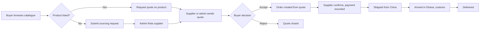

# China–Ghana Wholesale Marketplace (Demo)

A minimal, full-stack **Next.js + SQLite** demo of a B2B wholesale marketplace that connects Ghanaian retailers with manufacturers and wholesale suppliers in China.

Buyers can browse a catalogue of electronics and accessories, compare wholesale prices and minimum order quantities, submit sourcing requests, receive quotations, turn accepted quotations into orders, and follow each order through its shipping stages from China to Ghana.

> **This is a demo project.** All data is mock data seeded into a local SQLite file. No real payments, shipping, customs or supplier verification take place. Import cost figures are illustrative **estimates only** and do not represent official customs charges.

---

## Contents

- [What the demo covers](#what-the-demo-covers)
- [What the demo does not cover](#what-the-demo-does-not-cover)
- [Tech stack](#tech-stack)
- [Getting started](#getting-started)
- [Demo accounts](#demo-accounts)
- [Project structure](#project-structure)
- [Scripts](#scripts)
- [Core workflow](#core-workflow)
- [Related documents](#related-documents)

---

## What the demo covers

The demo implements the main marketplace loop end to end, for three roles.

**Buyers** (Ghanaian businesses) can register and log in, browse and search the product catalogue, filter by category, price and MOQ, view supplier profiles, request a quotation on a product, submit a sourcing request for a product that isn't listed, accept or reject quotations, see orders created from accepted quotations, follow an order's shipment timeline, and use an import cost estimator.

**Suppliers** (Chinese manufacturers and wholesalers) can manage a business profile, create and edit product listings with tiered wholesale prices and MOQs, respond to quotation requests, and update the status of their orders up to "Shipped from China".

**Administrators** can approve or reject supplier registrations, manage categories and listings, review sourcing requests and prepare quotations for them, manage all orders and move them through the Ghana-side stages (arrival, customs, delivery), and view a simple overview dashboard.

## What the demo does not cover

These are intentionally left out to keep the project small. They are noted in `architecture.md` as future work.

- Real payments (Paystack, Mobile Money, bank transfer). Payment status is a field an admin toggles.
- Real logistics or freight integrations. Shipment stages are updated manually.
- Real customs duty calculation. The estimator uses fixed mock percentages per category.
- Live exchange rates. USD → GHS and USD → CNY rates are seeded values an admin can edit.
- Messaging/chat, reviews and ratings, subscriptions, file uploads to object storage, email notifications.

## Tech stack

| Concern | Choice | Why |
|---|---|---|
| Framework | Next.js (App Router), TypeScript | One codebase for UI and server logic; Server Components for reads, Server Actions for writes |
| Styling | Tailwind CSS | Fast, consistent styling without a component library dependency |
| Database | SQLite (single file, `data/demo.db`) | Zero setup; perfect for a local demo |
| DB access | Drizzle ORM + `better-sqlite3` | Typed queries, light runtime, simple migrations |
| Validation | Zod | Same schemas validate forms and Server Action input |
| Auth | Email + password (`bcryptjs`), session row in SQLite, `httpOnly` cookie | Real enough to demonstrate role-based access without an external provider |
| Images | Static files in `public/products/` | No object storage needed for mock data |

Requirements: **Node.js 20+** and **Yarn 4** (Berry), managed through Corepack, which ships with Node:

```bash
corepack enable
```

The repo pins the Yarn version in `package.json` (`"packageManager": "yarn@4.x.x"`), so everyone on the project gets the same Yarn automatically. `.yarnrc.yml` sets `nodeLinker: node-modules` (see *Yarn setup* below for why).

## Getting started

```bash
# 1. Install dependencies
yarn install

# 2. Create the database schema
yarn db:push

# 3. Load mock data (users, suppliers, products, quotes, orders)
yarn db:seed

# 4. Start the dev server
yarn dev
```

Open http://localhost:3000.

To start over with fresh mock data at any time:

```bash
yarn db:reset
```

Optional `.env.local`:

```bash
DATABASE_URL=./data/demo.db
SESSION_COOKIE_NAME=cgm_session
```

## Demo accounts

All demo accounts use the password **`demo1234`**. The login page also has one-click "log in as…" buttons in development.

| Role | Email | Notes |
|---|---|---|
| Buyer | `kofi@demo.gh` | Kofi Electronics, Accra. Has open quotes and orders in several stages |
| Buyer | `ama@demo.gh` | Ama Gadgets, Kumasi. New buyer with an open sourcing request |
| Supplier | `sales@shenzhen-volt.demo` | Verified supplier of chargers and cables |
| Supplier | `hello@gz-audio.demo` | Verified supplier of earbuds and speakers |
| Supplier | `new@yiwu-cases.demo` | **Pending** verification (for testing admin approval) |
| Admin | `admin@demo.com` | Full marketplace operations access |

## Project structure

The code is organised by **feature slice**: each business capability owns its UI, data access, business rules and server actions in one folder. Routes in `app/` stay thin and compose slices together.

```
.
├── data/                        # SQLite database file (git-ignored)
├── public/products/             # Mock product images
├── src/
│   ├── app/                     # Routes only: thin pages that compose feature slices
│   │   ├── (public)/            # Landing, catalogue, product and supplier pages
│   │   ├── (auth)/              # Login, register
│   │   ├── buyer/               # Buyer area
│   │   ├── supplier/            # Supplier area
│   │   └── admin/               # Admin area
│   ├── features/                # One folder per business capability
│   │   ├── auth/                # Users, sessions, passwords, role guards
│   │   ├── suppliers/           # Business profiles, verification
│   │   ├── products/            # Catalogue, search, listings, price tiers, categories
│   │   ├── sourcing/            # Sourcing requests
│   │   ├── quotes/              # Quotation lifecycle
│   │   ├── orders/              # Orders, status transitions, shipment timeline
│   │   ├── estimates/           # Import cost estimator
│   │   ├── rates/               # Exchange rates
│   │   └── dashboard/           # Admin overview (read-only aggregates)
│   └── shared/                  # Code with no business meaning of its own
│       ├── db/                  # client.ts, schema.ts, transaction.ts, seed/
│       ├── ui/                  # Button, Input, Badge, Table, Dialog, layout primitives
│       └── lib/                 # money.ts, dates.ts, small utilities
├── middleware.ts                # Redirects unauthenticated users away from role areas
├── drizzle.config.ts
├── README.md
├── architecture.md
└── system-order-of-development.md
```

Every slice has the same shape:

```
src/features/quotes/
├── components/                  # QuoteTable, QuoteDetail, AcceptQuoteButton (client), ...
├── repositories/
│   └── quote.repository.ts      # SQL only, no business rules
├── services/
│   └── quote.service.ts         # Business rules; calls its own repository and other slices' index.ts
├── actions.ts                   # 'use server' — validate, authorize, call service, revalidate
├── schemas.ts                   # Zod schemas for action input
├── types.ts                     # Slice types (Quote, QuoteStatus, ...)
├── index.ts                     # Public API of the slice
└── __tests__/                   # Service tests
```

Rules of thumb: code outside a slice imports only from its `index.ts` (or `actions.ts` from client components); repositories are never exported; slices may depend on each other only in one direction. The full rules are in `architecture.md`.

## Scripts

| Script | What it does |
|---|---|
| `yarn dev` | Start the Next.js dev server |
| `yarn build` / `yarn start` | Production build and serve |
| `yarn db:push` | Apply `src/shared/db/schema.ts` to the SQLite file |
| `yarn db:seed` | Insert mock data |
| `yarn db:reset` | Delete the database file, push schema, re-seed |
| `yarn db:studio` | Open Drizzle Studio to browse the data |
| `yarn lint` | ESLint |
| `yarn test` | Unit tests for services (status transitions, cost estimate, quote → order) |

## Yarn setup

`.yarnrc.yml`:

```yaml
nodeLinker: node-modules
enableTelemetry: false
```

Yarn 4 defaults to Plug'n'Play (PnP), which removes `node_modules` and resolves packages through a `.pnp.cjs` map. It's fast and strict, but in this project it causes friction: `better-sqlite3` is a native module that builds into its package folder, and parts of the Next.js and Drizzle Kit tooling expect a real `node_modules` tree. The `node-modules` linker keeps Yarn 4's lockfile, workspaces and constraints while avoiding those compatibility issues.

Commit `package.json`, `yarn.lock` and `.yarnrc.yml`. Add these to `.gitignore`:

```
.yarn/*
!.yarn/releases
!.yarn/plugins
.pnp.*
node_modules/
```

Don't mix package managers: delete any `package-lock.json` and always add dependencies with `yarn add` / `yarn add -D`.

## Core workflow



## Related documents

- **[architecture.md](./architecture.md)** — system design, data model, module boundaries, auth and the reasoning behind key decisions.
- **[system-order-of-development.md](./system-order-of-development.md)** — the order in which to build the system, with milestones and "done" criteria for each step.

## Disclaimer

This project is for demonstration and learning purposes. Company names, products, prices, exchange rates, duty rates and shipping costs in the seed data are fictional. Nothing in the demo constitutes customs, tax or legal guidance for importing goods into Ghana.
# wholesale-sourcing-platform
