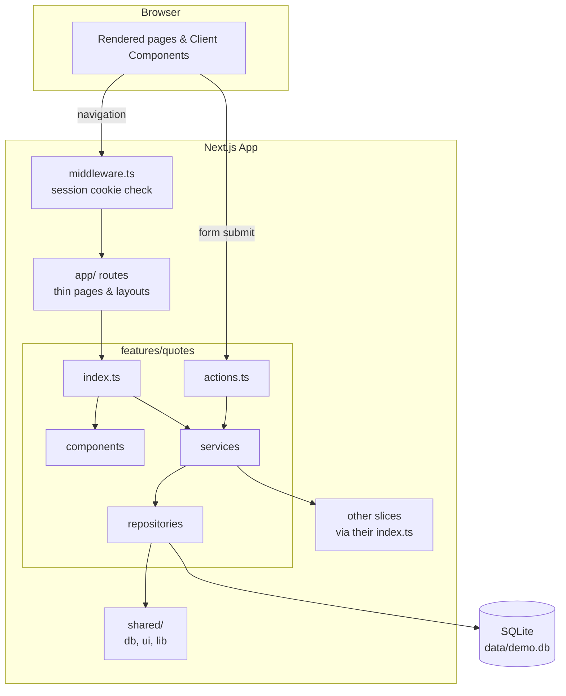
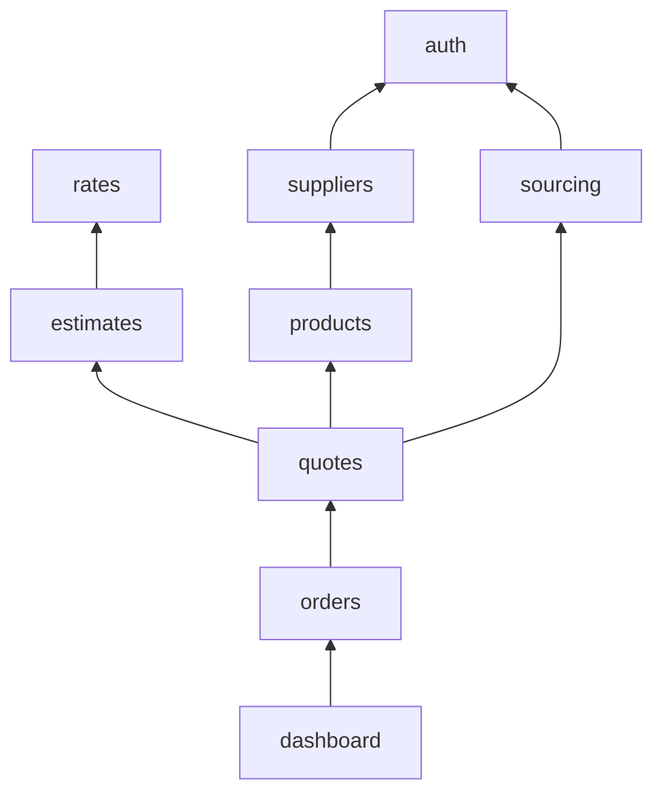
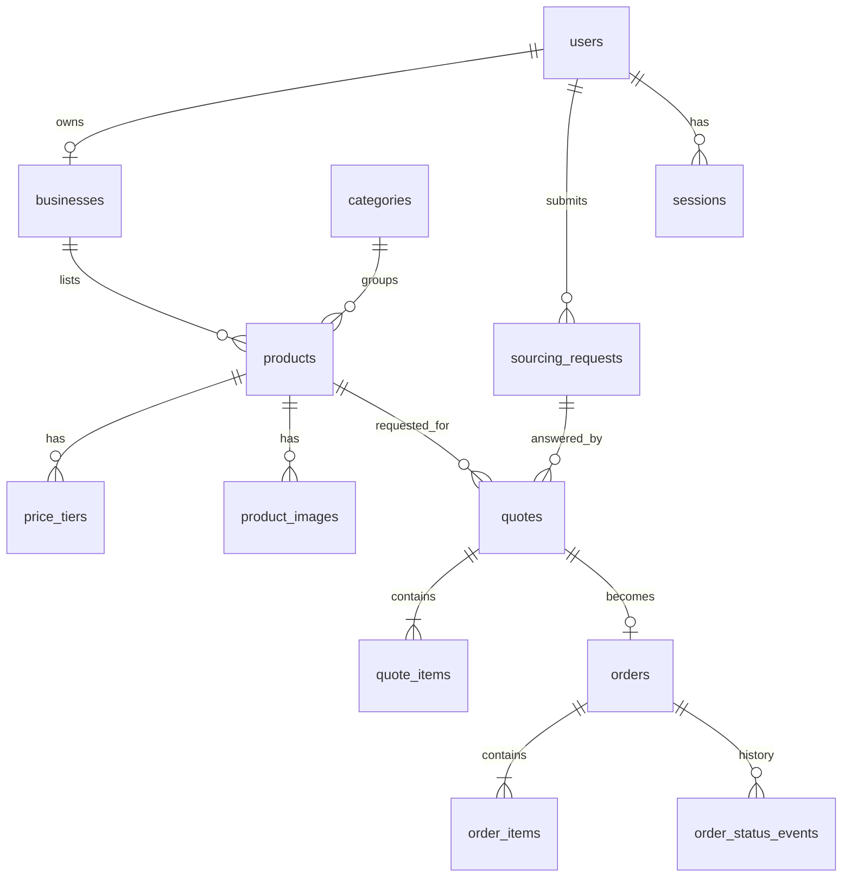
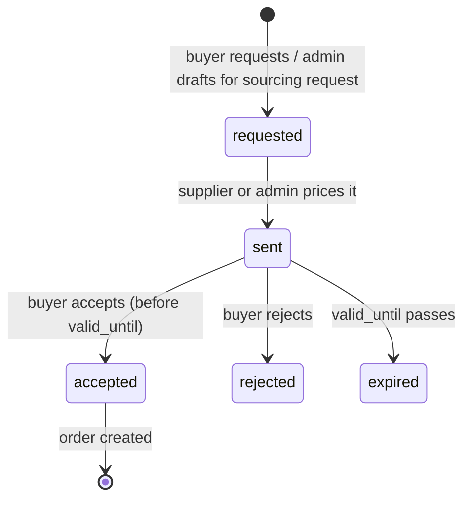
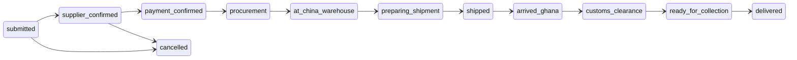

# Architecture

This document describes how the demo is put together and, more importantly, **why**. The project is intentionally minimal: a single full-stack Next.js application backed by a SQLite file full of mock data. Where a decision would change in a production version, that is called out.

---

## 1. Goals and constraints

**Goals**

- Demonstrate the full marketplace loop: catalogue → quote / sourcing request → quotation → order → shipment tracking.
- Show realistic role-based access for buyers, suppliers and admins.
- Keep each business capability (quotes, orders, products...) in its own feature slice with its own repositories, services, actions and components, and keep business rules testable.
- Run locally with `yarn install` and two commands. No Docker, no external services.

**Constraints**

- One Next.js app, no separate backend.
- SQLite with mock seed data.
- No real payments, logistics, customs or file storage.

---

## 2. High-level view: feature slices

The code is organised by **business capability** rather than by technical layer. Instead of one `services/` folder holding every service and one `components/` folder holding every component, each capability (quotes, orders, products...) is a self-contained slice under `src/features/` with its own layers inside it.



### 2.1 Why feature slices

| | Feature slices (chosen) | Layered folders (`services/`, `queries/`, `components/`) |
|---|---|---|
| Where is "everything about quotes"? | One folder | Spread across 4–5 folders |
| Adding a feature | Add a folder | Touch every layer folder |
| Deleting a feature | Delete a folder (and its imports) | Hunt through every layer |
| Hidden coupling | Visible: cross-slice imports go through `index.ts` | Any file can import any other |
| Cost | Some boilerplate per slice; must define slice boundaries well | Less structure to set up |

In a marketplace, most changes are about one capability at a time ("add an expiry reminder to quotes"), so grouping by capability keeps related changes together. The explicit `index.ts` boundary also makes dependencies between capabilities visible, which matters later if any slice is extracted into a separate service (for example, the Go backend from the original brief).

### 2.2 Slices

| Slice | Owns (tables) | Responsibility |
|---|---|---|
| `auth` | `users`, `sessions` | Register, login, logout, `getCurrentUser`, `requireRole` |
| `suppliers` | `businesses` | Buyer and supplier business profiles, supplier verification |
| `products` | `products`, `price_tiers`, `product_images`, `categories` | Public catalogue, search and filters, supplier listing management |
| `sourcing` | `sourcing_requests` | Buyer requests for unlisted products, admin review |
| `quotes` | `quotes`, `quote_items` | Quote lifecycle: request, price, send, reject, expiry |
| `orders` | `orders`, `order_items`, `order_status_events` | Quote acceptance → order, status transitions, shipment timeline |
| `estimates` | — (pure logic) | Import cost estimate calculation |
| `rates` | `exchange_rates` | Read and edit exchange rates |
| `dashboard` | — (reads only) | Admin overview aggregates |

Each table has **exactly one owning slice**. Only that slice's repositories write to it. Other slices that need the data call the owner's service through its `index.ts`. The one pragmatic exception is `dashboard`, whose repository may run read-only aggregate queries across tables, because routing a `COUNT(*) GROUP BY status` through five services adds nothing.

Shipment tracking lives inside `orders` rather than in its own slice because the timeline is just a view of `order_status_events`, which `orders` owns. Splitting it would create a slice with no data of its own.

### 2.3 Inside a slice

```
src/features/quotes/
├── components/
│   ├── quote-table.tsx            # Server Component
│   ├── quote-detail.tsx           # Server Component
│   └── accept-quote-button.tsx    # 'use client'
├── repositories/
│   └── quote.repository.ts
├── services/
│   └── quote.service.ts
├── actions.ts
├── schemas.ts
├── types.ts
├── index.ts
└── __tests__/
    └── quote.service.test.ts
```

| File / folder | Responsibility | May import | Must not |
|---|---|---|---|
| `repositories/` | SQL via Drizzle for the slice's own tables. Every query that returns user data takes the owner id as a parameter. Accepts an optional transaction handle. | `shared/db` | Contain business rules; touch other slices' tables; be exported from `index.ts` |
| `services/` | Business rules, state transitions, orchestration. Exposes read functions for pages too (e.g. `getQuoteForBuyer`). | Own repositories, other slices' `index.ts`, `shared/lib` | Know about cookies, forms, `revalidatePath` or HTTP |
| `actions.ts` | `'use server'` entry points. Parse input with Zod, call `requireRole`, call a service, `revalidatePath`, return a form state. | Own services, own schemas, `@/features/auth` | Contain business rules or SQL |
| `components/` | UI for this capability. Server Components fetch via the slice's services; Client Components receive data as props and call actions. | Own services (server components only), own actions, `shared/ui` | Import another slice's internals |
| `schemas.ts` | Zod schemas for action input; reused by client forms for instant validation. | `zod` | — |
| `types.ts` | Domain types and status unions, mostly inferred from the Drizzle schema. | `shared/db` types | — |
| `index.ts` | The slice's **public API**: service functions other code may call, Server Components pages may render, public types. | Anything in the slice | Export repositories |

Repositories and services start with `import 'server-only'`, so a mistaken import from a Client Component fails at build time instead of leaking database code into the browser bundle.

### 2.4 Import rules

1. **Code outside a slice imports from `@/features/<slice>` (its `index.ts`) only.** Deep imports such as `@/features/quotes/repositories/...` are forbidden.
2. **The one other public entry point is `@/features/<slice>/actions`.** Client Components can't import `index.ts` because it re-exports server-only services, so they import actions directly. (Actions are safe in client code; Next.js turns them into references to server endpoints.)
3. **Slices depend on each other in one direction only.** No cycles:



   (Arrows point at what a slice depends on.) If two slices seem to need each other, either the shared piece belongs in the lower slice, or the higher slice should orchestrate. Example: accepting a quote creates an order, so `acceptQuote` lives in `orders` (which depends on `quotes`), not in `quotes`.
4. **`shared/` never imports from `features/`.** If shared code needs to know about quotes, it isn't shared code.
5. **`app/` routes contain no logic.** A page calls `requireRole`, fetches through slice services and renders slice components.

These are enforced with ESLint `no-restricted-imports`:

```js
// eslint.config.mjs (excerpt)
'no-restricted-imports': ['error', {
  patterns: [{
    group: ['@/features/*/*', '!@/features/*/actions'],
    message: 'Import from the slice index (or its actions) instead of its internals.',
  }],
}],
```

Inside a slice, files use relative imports (`../repositories/quote.repository`), which the rule doesn't affect. For the cycle rule, `eslint-plugin-boundaries` can be added later; in a project this size, reviewing the dependency diagram is enough.

### 2.5 Transactions across slices

Some operations span slices. Accepting a quote must update `quotes` (owned by `quotes`) and insert into `orders` (owned by `orders`) atomically.

`shared/db/transaction.ts` exposes `withTransaction(fn)`. Repository functions accept an optional `tx` argument and use it instead of the default connection. The orchestrating service opens the transaction and passes `tx` down, including into the other slice's service:

```ts
// features/orders/services/order.service.ts
export function acceptQuote(buyerId: number, quoteId: number) {
  return withTransaction((tx) => {
    const quote = quotesService.markAccepted(buyerId, quoteId, tx); // from '@/features/quotes'
    return orderRepository.createFromQuote(quote, tx);
  });
}
```

Note: `better-sqlite3` transactions are **synchronous**. Repository and service functions that run inside a transaction must be synchronous too (no `await` inside the callback). This is a quirk of SQLite in Node; with PostgreSQL, the same pattern becomes `async`.

### 2.6 Example: a page composing slices

```tsx
// app/buyer/quotes/[id]/page.tsx
import { requireRole } from '@/features/auth';
import { getQuoteForBuyer, QuoteDetail } from '@/features/quotes';
import { notFound } from 'next/navigation';

export default async function Page({ params }: { params: Promise<{ id: string }> }) {
  const user = await requireRole('buyer');
  const quote = getQuoteForBuyer(user.id, Number((await params).id));
  if (!quote) notFound();
  return <QuoteDetail quote={quote} viewer="buyer" />;
}
```

The page decides **who** and **which**; the slice decides **what** and **how**.

---

## 3. Key decisions and trade-offs

### 3.1 Full-stack Next.js instead of Next.js + Go

| | Full-stack Next.js (chosen) | Next.js + Go REST API |
|---|---|---|
| Setup | One process, one language | Two services, two toolchains, CORS, API contracts |
| Type safety | Shared TypeScript types end to end | Needs OpenAPI or hand-synced types |
| Fit for a demo | Excellent | Overkill |
| Fit for production scale | Fine for a long while | Better for independent scaling, background workers, separate teams |

For a demo, the extra service adds work without showing anything new about the business.

### 3.2 Server Actions instead of a REST API

Mutations are Server Actions (`'use server'` functions called from forms). They give progressive enhancement, no hand-written fetch code, and automatic revalidation with `revalidatePath`.

Trade-off: Server Actions are not a public API. If a mobile app or a third party needs access later, add Route Handlers under `app/api/` that call the **same slice services** through their `index.ts`. Because business logic lives in services, this is additive work, not a rewrite.

A small number of Route Handlers are still used where a URL-addressable JSON endpoint is natural, e.g. `GET /api/estimate` for the live cost estimator.

### 3.3 SQLite + Drizzle

SQLite needs no server and the whole database is one file you can delete and re-seed. Drizzle gives typed queries without heavy code generation, and its schema file doubles as documentation.

Trade-offs to know about:

- `better-sqlite3` is synchronous and native. That is fine (and fast) locally but means the demo should be deployed somewhere with a persistent disk (a small VM, Fly.io, Railway). Serverless platforms with ephemeral filesystems will lose writes.
- SQLite has no native enum or decimal type. Enums are `TEXT` with a `CHECK` constraint; money is stored as integers (see 3.5).
- Foreign keys must be switched on per connection: `PRAGMA foreign_keys = ON;` in `shared/db/client.ts`.

Moving to PostgreSQL later is mostly a driver and dialect change in Drizzle.

**Why the schema stays in `shared/db/schema.ts` instead of inside each slice:** tables reference each other with foreign keys across slice boundaries (`orders.quote_id → quotes.id`). Splitting the schema per slice would force slices to import each other's table definitions, creating exactly the cross-slice coupling the structure is meant to prevent. One schema file keeps the database as a single, readable picture; **ownership** (which slice may write which table) is enforced in repositories instead (see §2.2).

### 3.4 Simple first-party auth

Email + password with `bcryptjs`, a `sessions` table, and an `httpOnly`, `SameSite=Lax` cookie holding a random session id. No third-party provider.

Why not a mock "pick a role" switcher only? Because authorization (who can see which quote) is one of the most important things a marketplace gets right, and it is only meaningful if users are real rows with real ownership. The login page still offers one-click demo logins for convenience.

### 3.5 Money as integers in minor units

All prices are stored as **integers in USD cents** (`unit_price_minor = 1250` means $12.50), with a `currency` column. Floating-point arithmetic on money produces rounding errors that compound across quantity × price × fees.

- Supplier prices are entered in USD (the common wholesale quoting currency).
- GHS and CNY are display conversions using the `exchange_rates` table.
- When a quote is sent, the exchange rate used is **snapshotted onto the quote**, so the buyer sees the same GHS figure later even if the rate changes. This mirrors a real-world problem the brief highlights: exchange rate movement between quoting and paying.

### 3.6 Snapshots instead of live references

Orders copy product name, unit price and quantity from the accepted quote into `order_items`. If a supplier later edits or deletes a product, historical orders are unaffected. The same applies to quote line items. This is standard practice for anything that represents an agreement.

### 3.7 Status history as an append-only table

Orders have a `status` column **and** an `order_status_events` table. The column makes listing and filtering fast; the events table gives the shipment timeline, who changed what, and when. Status changes go through one service function that validates the transition and writes both in a single transaction.

---

## 4. Domain model

### 4.1 Entity relationships



### 4.2 Tables

Common columns on every table: `id INTEGER PRIMARY KEY`, `created_at`, `updated_at` (ISO strings).

**users**

| Column | Type | Notes |
|---|---|---|
| email | TEXT UNIQUE NOT NULL | lower-cased |
| password_hash | TEXT NOT NULL | bcrypt |
| name | TEXT NOT NULL | |
| role | TEXT NOT NULL | `buyer` \| `supplier` \| `admin` |

**sessions** — `id TEXT PK` (random 32 bytes, hex), `user_id FK`, `expires_at`.

**businesses** — one per buyer or supplier user.

| Column | Type | Notes |
|---|---|---|
| owner_id | FK users UNIQUE | |
| type | TEXT | `buyer` \| `supplier` |
| name | TEXT NOT NULL | |
| country | TEXT | `GH` or `CN` |
| city | TEXT | |
| description | TEXT | |
| verification_status | TEXT | `pending` \| `verified` \| `rejected` (suppliers only) |
| years_in_business | INTEGER | supplier profile detail |

Buyers and suppliers share one table because they hold almost identical data. A `type` column is simpler than two near-duplicate tables.

**categories** — `name`, `slug UNIQUE`, `parent_id FK categories NULL`, `duty_rate_bps INTEGER` (mock estimated duty in basis points, used only by the estimator).

**products**

| Column | Type | Notes |
|---|---|---|
| supplier_id | FK businesses | |
| category_id | FK categories | |
| name, slug, description | TEXT | |
| specs_json | TEXT | key/value specs, e.g. `{"Output":"20W","Port":"USB-C"}` |
| moq | INTEGER NOT NULL CHECK > 0 | minimum order quantity |
| unit_weight_g | INTEGER | for freight estimates |
| stock_status | TEXT | `in_stock` \| `made_to_order` |
| lead_time_days | INTEGER | |
| status | TEXT | `active` \| `hidden` |

**price_tiers** — `product_id FK`, `min_qty INTEGER`, `unit_price_minor INTEGER`, `currency TEXT DEFAULT 'USD'`. Unique on `(product_id, min_qty)`. The lowest tier's `min_qty` must equal the product MOQ (checked in the service).

**product_images** — `product_id FK`, `url`, `sort_order`.

**sourcing_requests**

| Column | Type | Notes |
|---|---|---|
| buyer_id | FK users | |
| product_name, description | TEXT | |
| reference_url | TEXT NULL | link or image URL |
| quantity | INTEGER NOT NULL | |
| target_price_minor | INTEGER NULL | |
| status | TEXT | `open` \| `in_review` \| `quoted` \| `closed` |
| admin_notes | TEXT NULL | internal only, never sent to buyer |

**quotes**

| Column | Type | Notes |
|---|---|---|
| buyer_id | FK users | |
| supplier_id | FK businesses NULL | null until admin assigns one for a sourcing request |
| product_id | FK products NULL | set when requested from a listing |
| sourcing_request_id | FK sourcing_requests NULL | set when answering a sourcing request |
| status | TEXT | `requested` \| `sent` \| `accepted` \| `rejected` \| `expired` |
| shipping_method | TEXT | `air` \| `sea` |
| freight_minor, fees_minor, est_duty_minor | INTEGER | estimate components |
| fx_usd_ghs | REAL | rate snapshot at time of sending |
| valid_until | TEXT | |
| buyer_message, response_message | TEXT | |

`CHECK (product_id IS NOT NULL OR sourcing_request_id IS NOT NULL)` ensures every quote has an origin.

**quote_items** — `quote_id FK`, `description`, `quantity`, `unit_price_minor`.

**orders**

| Column | Type | Notes |
|---|---|---|
| quote_id | FK quotes UNIQUE | one order per accepted quote |
| buyer_id | FK users | |
| supplier_id | FK businesses | |
| status | TEXT | see state machine below |
| payment_status | TEXT | `unpaid` \| `paid` \| `refunded` |
| total_minor | INTEGER | snapshot |
| shipping_method | TEXT | |
| tracking_ref | TEXT NULL | |

**order_items** — snapshot copy of `quote_items` plus `order_id FK`.

**order_status_events** — `order_id FK`, `from_status`, `to_status`, `changed_by FK users`, `note`, `created_at`.

**exchange_rates** — `base`, `quote`, `rate REAL`, `updated_at`. Seeded with USD→GHS and USD→CNY.

### 4.3 Indexes

`products(category_id, status)`, `products(supplier_id)`, `quotes(buyer_id, status)`, `quotes(supplier_id, status)`, `orders(buyer_id)`, `orders(supplier_id)`, `order_status_events(order_id, created_at)`. Product search uses `LIKE` on name and description; SQLite FTS5 is an easy upgrade if needed.

---

## 5. Business rules (services)

### 5.1 Quote lifecycle



Rules enforced in `features/quotes/services/quote.service.ts`:

- Only the owning supplier (or an admin) can move `requested → sent`.
- Line item quantities must be ≥ the product MOQ when the quote is tied to a product.
- Only the owning buyer can accept or reject, and only while `sent` and not expired. Expiry is checked on read and on accept rather than by a background job; that keeps the demo free of schedulers.
- **Accepting a quote and creating the order happen in one database transaction.** Either both succeed or neither does, so there is never an accepted quote without an order. The orchestration lives in `orders` (see §2.5); `quotes` exposes `markAccepted(..., tx)` for it.

### 5.2 Order state machine



The brief notes that not every shipment uses every stage, so the transition table allows skipping **forward** (e.g. `payment_confirmed → shipped` for in-stock goods sent straight from the supplier) but never moving backward. Cancellation is only allowed before payment.

Who can move what:

| Transition range | Allowed by |
|---|---|
| `submitted → supplier_confirmed` | supplier, admin |
| `→ payment_confirmed` | admin (stands in for a payment provider webhook) |
| `procurement → shipped` | supplier, admin |
| `arrived_ghana → delivered` | admin (stands in for the logistics partner) |
| `→ cancelled` | buyer (before confirmation), admin |

The whole table lives in one `ORDER_TRANSITIONS` constant in `features/orders/services/order-transitions.ts`, so changing the workflow means editing one object and its tests.

### 5.3 Import cost estimator

`features/estimates/services/estimate.service.ts` is a pure function, easy to unit test. It takes the exchange rate as an input (fetched via `@/features/rates` by the caller) so the calculation itself never touches the database:

```
product_cost   = Σ quantity × unit_price
china_transport = flat mock fee
freight        = total_weight_kg × rate_per_kg[air|sea]
insurance      = 1% of (product_cost + freight)          (optional)
customs_value  = product_cost + freight + insurance
est_duty_taxes = customs_value × category.duty_rate_bps / 10000
local_delivery = flat mock fee by city
platform_fee   = 3% of product_cost
total          = sum of the above, shown in USD and GHS
```

Every figure is labelled **"Estimate"** in the UI, with a note that actual duties and taxes are assessed by Ghanaian customs authorities and depend on classification, valuation and current regulations. The duty rates in the seed data are placeholders, not real tariff rates.

---

## 6. Authentication and authorization

### 6.1 Authentication

1. Login form posts to a Server Action.
2. Action validates with Zod, looks up the user, compares with `bcrypt.compare`.
3. On success, inserts a `sessions` row and sets the cookie (`httpOnly`, `SameSite=Lax`, `Secure` in production, 7-day expiry).
4. `getCurrentUser()` in `features/auth` reads the cookie and joins `sessions → users`. It is wrapped in React `cache()` so a page calls the DB once per request.
5. Logout deletes the session row and clears the cookie.

### 6.2 Authorization, in two layers

**Layer 1 — `middleware.ts` (coarse).** If there is no session cookie, redirect `/buyer/*`, `/supplier/*` and `/admin/*` to `/login`. Middleware only checks that a cookie exists; it does not hit the database.

**Layer 2 — guards in every Server Component and Server Action (authoritative).**

```ts
import { requireRole } from '@/features/auth';
import { getQuoteForSupplier } from '@/features/quotes';

const user = await requireRole('supplier');      // redirects if wrong role
const quote = getQuoteForSupplier(user.id, id);  // repository query is scoped by owner
```

Middleware alone is never trusted, because Server Actions can be invoked directly. The important pattern is **scoping queries by owner** (`WHERE supplier_id = ?`) rather than fetching a record and then checking ownership; it makes it hard to accidentally leak another business's data. In the slice structure this is a repository convention: any repository function returning user-owned rows takes the owner id as its first argument.

Additional rules:

- Unverified suppliers can log in and edit their profile, but their products are hidden from the public catalogue and they cannot receive quotes.
- `admin_notes` on sourcing requests and supplier verification details are never selected in buyer- or supplier-facing queries.
- All Server Action input is parsed with Zod; IDs from the client are treated as untrusted.

---

## 7. Application structure

### 7.1 Routes

| Area | Route | Purpose |
|---|---|---|
| Public | `/` | Landing page, featured categories |
| | `/products` | Catalogue with search, category, price and MOQ filters (URL search params) |
| | `/products/[slug]` | Product detail, price tiers, supplier card, "Request quote" |
| | `/suppliers/[id]` | Supplier profile and listings |
| Auth | `/login`, `/register` | Register as buyer or supplier |
| Buyer | `/buyer` | Overview: open quotes, active orders |
| | `/buyer/sourcing`, `/buyer/sourcing/new` | Sourcing requests |
| | `/buyer/quotes`, `/buyer/quotes/[id]` | View, accept, reject |
| | `/buyer/orders`, `/buyer/orders/[id]` | Order detail with shipment timeline |
| | `/buyer/estimate` | Import cost estimator |
| Supplier | `/supplier` | Overview |
| | `/supplier/profile` | Business profile, verification status |
| | `/supplier/products`, `/new`, `/[id]/edit` | Listing management |
| | `/supplier/quotes/[id]` | Price and send quotes |
| | `/supplier/orders/[id]` | Update fulfilment status |
| Admin | `/admin` | Counts, recent activity, orders by status |
| | `/admin/suppliers` | Approve / reject |
| | `/admin/sourcing/[id]` | Assign supplier, draft quote |
| | `/admin/orders/[id]` | All statuses, payment flag |
| | `/admin/categories`, `/admin/rates` | Categories and exchange rates |

Each role area has its own `layout.tsx` that calls `requireRole()` once and renders that role's navigation.

### 7.2 Server vs Client Components

Pages are Server Components by default: they read data through slice services exported from each `index.ts`, so there is no loading spinner on first paint and no API to write. Client Components are used only where interaction needs browser state:

- Catalogue filter controls (update URL search params).
- Price tier editor on the product form (add/remove rows).
- Live cost estimator.
- Confirmation dialogs for accept / reject / cancel.

Forms use Server Actions with `useActionState` to show validation errors returned from Zod. A Client Component imports its slice's actions with a relative import (`../actions`) or, from another slice, via `@/features/<slice>/actions`.

---

## 8. Mock data

`src/shared/db/seed/` creates a believable, small dataset. It is split into one file per slice (`users.ts`, `products.ts`, `quotes.ts`, `orders.ts`...) run in dependency order by `seed/index.ts`. Seeds write directly with Drizzle rather than through services, because they set up states (an order already `shipped`, a quote already expired) that the business rules would rightly refuse to produce:

- 1 admin, 2 buyers (Accra, Kumasi), 3 suppliers (Shenzhen, Guangzhou, Yiwu; one pending verification).
- ~6 categories (phone accessories, chargers & cables, audio, power banks, smart wearables, cases).
- ~30 products with 2–3 price tiers each and realistic MOQs (50–1,000 units).
- Quotes in every status, including one expiring soon.
- Orders spread across the shipment stages, each with a matching event history.
- Exchange rates and per-category mock duty rates.

Seeding is deterministic (fixed values, no random generation) so screenshots and walkthroughs are repeatable.

---

## 9. Testing

Focus tests where bugs would be costly, not on UI snapshots:

- `features/orders` — every allowed and disallowed transition, and role permissions.
- `features/quotes` — accept → order in one transaction; expired quotes can't be accepted; MOQ enforcement.
- `features/estimates` — known inputs produce known outputs; no floating-point drift.
- Authorization — a buyer cannot read another buyer's quote; a supplier cannot update another supplier's order.

Tests live in each slice's `__tests__/` folder and test **services**, not repositories, since services are where the rules are. Vitest against an in-memory SQLite database (`:memory:`) keeps these fast and isolated.

---

## 10. From demo to production

What would change if this became a real product, roughly in priority order:

1. **Supplier verification and trust.** Document upload (business licence), manual review workflow, trade history, credible reviews tied to completed orders. This is the core problem in China–Ghana sourcing and the main gap in the brief's business model.
2. **Payments.** Paystack (cards, Mobile Money) for GHS collection, plus a settlement path to suppliers in USD/CNY. Likely escrow-style: hold funds until goods reach the China warehouse. Payment status moves from admin-toggled to webhook-driven.
3. **Database.** PostgreSQL with the same Drizzle schema, real enums and `NUMERIC`.
4. **Files.** S3-compatible storage for product images and verification documents.
5. **Logistics partners.** Integration or at least structured handoff to freight forwarders, since the brief says the platform won't run warehouses or clearance itself.
6. **Background jobs.** Quote expiry, notifications and exchange-rate refresh via a job queue.
7. **Restricted goods.** Category-level flags and checks for regulated items (e.g. items needing approvals from Ghanaian standards or communications authorities).
8. **Separate backend.** Move slices into a Go API if scale, team structure or other clients justify it. Each slice's `index.ts` is effectively an internal API contract, so a slice can be replaced by a client that calls a remote service with the same function signatures, one slice at a time.
