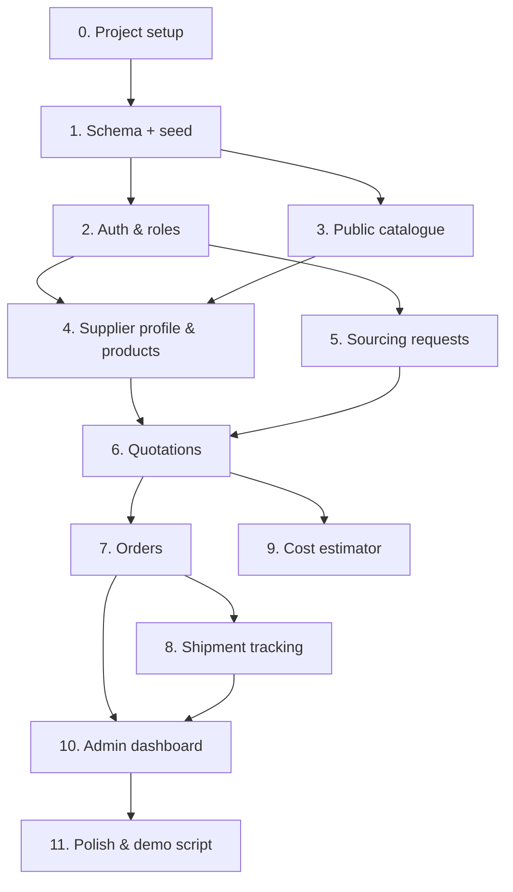

# System Order of Development

This is the order to build the demo in. Each step depends only on steps before it, so the app stays runnable after every milestone. Every step ends with a **Done when** checklist; don't move on until it passes.

See `architecture.md` for the reasoning behind the design choices referred to here.

---

## Why this order

Four principles drive it:

1. **One slice per step.** Each step (from step 2) builds one feature slice end to end: repository → service → actions → components → pages. You finish a vertical slice of working behaviour rather than a horizontal layer of half-used code.
2. **Data before screens.** The schema and seed come first so every later page has realistic data to render from day one. You never build a page against an empty database.
3. **Read before write.** The catalogue (read-only) is built before product editing, and viewing quotes before accepting them. Reads are simpler, and they give you a way to see the results of writes when you add them.
4. **Follow the money.** Quotes → orders → tracking follows the order a real transaction happens in. Each step consumes what the previous one produces.

Rough sizing assumes one developer working part-time; adjust to your pace.

---

## Step 0 — Project setup
*~0.5 day*

- Create the Next.js app with TypeScript, App Router, Tailwind and ESLint.
- Add `drizzle-orm`, `better-sqlite3`, `drizzle-kit`, `zod`, `bcryptjs`, `tsx`, `vitest`.
- Add `server-only`.
- Create `src/app`, `src/features` and `src/shared/{db,ui,lib}`. Don't create slice folders yet; each is created by the step that builds it.
- Add the ESLint `no-restricted-imports` rule from `architecture.md` §2.4 so slice boundaries are enforced from the first commit.
- Enable Corepack, set Yarn 4 with `yarn set version stable` (this writes `packageManager` into `package.json`), and create `.yarnrc.yml` with `nodeLinker: node-modules`. Create the app with `yarn create next-app`, then add dependencies with `yarn add` / `yarn add -D`.
- Add `package.json` scripts: `db:push`, `db:seed`, `db:reset`, `db:studio`, `test`.
- Create `shared/db/client.ts` that opens `data/demo.db` and runs `PRAGMA foreign_keys = ON`, and `shared/db/transaction.ts` with `withTransaction(fn)`.
- Build the base `shared/ui` primitives you'll need everywhere: Button, Input, Badge, Card, Table.
- Add `data/` to `.gitignore`.
- Build a basic app shell: header, footer, a placeholder home page.

**Done when**
- [ ] A fresh clone runs with `corepack enable && yarn install && yarn dev`.
- [ ] `yarn dev` shows the shell.
- [ ] `yarn test` runs (even with one trivial test).
- [ ] Importing the DB client in a Server Component doesn't error.
- [ ] A deliberate deep import like `@/features/x/repositories/y` in a page is flagged by ESLint.

---

## Step 1 — Database schema and mock data
*~1.5 days*

- Write all tables in `shared/db/schema.ts` (see `architecture.md` §4). Write the whole schema now, even for features you'll build later; changing a schema that already has seed data and queries against it is more work than getting it mostly right up front.
- Include `CHECK` constraints for status columns and for `moq > 0`.
- Write `shared/lib/money.ts`: `formatMoney(minor, currency)`, `toGhs(minorUsd, rate)`. Add unit tests now.
- Write `shared/db/seed/` with one file per slice and an `index.ts` that runs them in dependency order. Deterministic mock data: users, businesses, categories, ~30 products with price tiers and images, exchange rates. Quote and order seed files can wait until steps 6–7 but stub them now.
- Add placeholder product images to `public/products/`.

**Done when**
- [ ] `yarn db:reset` creates and fills the database without errors.
- [ ] Drizzle Studio shows the data with correct relationships.
- [ ] Inserting a product with a bad `category_id` fails (foreign keys are on).

---

## Step 2 — Authentication and roles (`features/auth`)
*~1.5 days*

This is the first slice, so it also sets the template every other slice copies.

- `repositories/user.repository.ts`, `repositories/session.repository.ts`.
- `services/password.service.ts` (bcrypt), `services/session.service.ts` (create, read, delete sessions; cookie helpers), `services/guards.ts` — `getCurrentUser()` (wrapped in `cache()`), `requireUser()`, `requireRole(role)`.
- `schemas.ts` (login, register), `actions.ts` (`login`, `register`, `logout`), `components/` (LoginForm, RegisterForm, DemoLoginButtons).
- `index.ts` exports `getCurrentUser`, `requireUser`, `requireRole`, the form components and the `Role` type. Nothing else.
- `/login` and `/register` pages render the slice's components. Registration asks for buyer or supplier and creates the matching `businesses` row (suppliers start `pending`). Because `businesses` is owned by `suppliers`, create a minimal `features/suppliers` with just `createBusiness` in its service, or temporarily let registration call the `suppliers` repository through a service you'll grow in step 4. Don't write to `businesses` from `auth`.
- One-click demo login buttons, shown only when `NODE_ENV !== 'production'`.
- `middleware.ts` redirects unauthenticated users away from `/buyer`, `/supplier`, `/admin`.
- Empty `layout.tsx` for each role area that calls `requireRole()` and renders role navigation.
- Logout.

**Done when**
- [ ] Each demo account logs in and lands in its own area.
- [ ] A buyer visiting `/admin` is redirected or sees a 403, not the page.
- [ ] Session survives a refresh; logout ends it.
- [ ] Passwords in the DB are hashes.
- [ ] No file outside `features/auth` imports anything but `@/features/auth` or `@/features/auth/actions`.

---

## Step 3 — Public catalogue (`features/products`, read side)
*~2 days*

- `repositories/product.repository.ts`, `repositories/category.repository.ts`.
- `services/catalogue.service.ts`: `listProducts({ q, category, minPrice, maxPrice, maxMoq, page })`, `getProductBySlug`, `listCategories`.
- `features/suppliers` service: `getPublicSupplierProfile`.
- Only show products that are `active` **and** belong to a `verified` supplier. Put that rule in the repository query the catalogue service uses, not the page.
- Components: ProductCard, ProductGrid, CatalogueFilters (client), PriceTierTable, SupplierCard (in `suppliers`).
- `/products` with search box and filters driven by URL search params, so filtered views are shareable and the back button works.
- `/products/[slug]` with images, specs, price tier table, MOQ, lead time and a supplier card.
- `/suppliers/[id]` profile page with their listings.
- Show prices in USD with an approximate GHS figure using the seeded exchange rate.
- Home page with featured categories.

**Done when**
- [ ] Search and each filter narrow results correctly and combine.
- [ ] Products from the pending Yiwu supplier never appear.
- [ ] Pages work with JavaScript disabled (except filter auto-submit).

---

## Step 4 — Supplier profile and product management (`features/suppliers`, `features/products` write side)
*~2 days*

- `/supplier/profile` — edit business details; show verification status badge.
- `/supplier/products` — list own products.
- `/supplier/products/new` and `/[id]/edit` — product form with a Client Component price-tier editor.
- `products/services/listing.service.ts` — validate: at least one tier, tiers strictly increasing in `min_qty`, lowest tier equals MOQ, prices > 0. Scope all updates by `supplier_id`.
- Hide/unhide a product.
- Image fields accept URLs from `public/products/` (no uploads in the demo).

**Done when**
- [ ] A supplier can create a product and see it in the public catalogue (if verified).
- [ ] Invalid tier setups are rejected with clear form errors.
- [ ] A supplier cannot edit another supplier's product by changing the ID in the URL.
- [ ] Unit tests cover tier validation.

---

## Step 5 — Sourcing requests (`features/sourcing`)
*~1 day*

- `/buyer/sourcing/new` — form: product name, description, reference URL, quantity, optional target price, extra requirements.
- `/buyer/sourcing` — list own requests with status.
- `/admin/sourcing` and `/admin/sourcing/[id]` — list all, view one, set `in_review`, add internal notes.
- Make sure `admin_notes` is excluded from buyer queries: have separate repository functions (`findForBuyer`, `findForAdmin`) rather than one function with a flag.

**Done when**
- [ ] Buyer submits a request and sees it as `open`.
- [ ] Admin sees it, moves it to `in_review` and adds a note the buyer can't see.

---

## Step 6 — Quotations (`features/quotes`)
*~2.5 days — the most important step*

- `services/quote.service.ts`:
  - `requestQuoteForProduct(buyer, productId, qty, message)` → `requested`, enforces MOQ.
  - `createQuoteForSourcingRequest(admin, requestId, supplierId, items)` → sets request to `quoted`.
  - `sendQuote(actor, quoteId, items, shippingMethod, validUntil)` → `sent`; snapshots the exchange rate; calculates estimate fields using the estimator function (stub it now, finish in step 9).
  - `rejectQuote(buyer, quoteId)`.
  - `markAccepted(buyer, quoteId, tx)` — validates and updates the quote inside a caller's transaction. Exported for `orders` in step 7; not called by any action in this slice.
  - `isExpired(quote)` checked on read and before accept.
- "Request quote" button and form on the product page.
- Buyer: `/buyer/quotes`, `/buyer/quotes/[id]` with line items, totals in USD and GHS, validity, accept/reject buttons.
- Supplier: list of incoming requests, `/supplier/quotes/[id]` to price and send.
- Admin: draft quote from the sourcing request page.
- Extend the seed with quotes in every status.
- Leave **accept** as a disabled button; it is wired up in step 7 together with order creation.

**Done when**
- [ ] Both quote paths work: from a product and from a sourcing request.
- [ ] Quantities below MOQ are rejected.
- [ ] Expired quotes display as expired and can't be acted on.
- [ ] Buyers and suppliers only see their own quotes.
- [ ] Unit tests cover the quote state rules.

---

## Step 7 — Orders (`features/orders`)
*~2 days*

- `services/order.service.ts`:
  - `acceptQuote(buyer, quoteId)` — **one transaction** via `withTransaction`, calling `markAccepted` from `@/features/quotes`: mark quote `accepted`, create the order, copy items into `order_items`, compute `total_minor`, write the first `order_status_events` row (`submitted`).
  - `ORDER_TRANSITIONS` table and `changeOrderStatus(actor, orderId, toStatus, note)` that checks the transition and the actor's permission, then updates `orders.status` and inserts an event in one transaction.
  - `cancelOrder` (buyer before confirmation, admin before payment).
- `orders/actions.ts` gets `acceptQuoteAction`. Enable the accept button on the buyer quote page; the button component lives in `quotes` and imports the action from `@/features/orders/actions`. That is the allowed cross-slice entry point for client code, and it doesn't create a cycle because it's a UI-level reference, not a service dependency. (If you prefer zero cross-slice imports in `quotes`, render the button from the page and pass the action as a prop.)
- Buyer: `/buyer/orders`, `/buyer/orders/[id]`.
- Supplier: order list and `/supplier/orders/[id]` with only the transitions they are allowed to make.
- Extend the seed with orders at various stages and their event history.

**Done when**
- [ ] Accepting a quote creates exactly one order; accepting twice does nothing the second time.
- [ ] If order creation fails mid-way (force an error in a test), the quote is still `sent`.
- [ ] Disallowed transitions are rejected in the service, not just hidden in the UI.
- [ ] Unit tests cover every transition and role permission.

---

## Step 8 — Shipment tracking (inside `features/orders`)
*~1 day*

- Timeline component on the order detail page built from `order_status_events`: completed stages with date and note, current stage highlighted, remaining stages greyed out, skipped stages shown as skipped.
- Optional `tracking_ref` field editable by supplier/admin once shipped.
- Same timeline reused on buyer, supplier and admin order pages.

**Done when**
- [ ] Seeded orders each show a correct, readable timeline.
- [ ] Skipping forward (e.g. straight to `shipped`) displays sensibly.

---

## Step 9 — Import cost estimator (`features/estimates`, `features/rates`)
*~1.5 days*

- Finish `estimates/services/estimate.service.ts` as a pure function (formula in `architecture.md` §5.3).
- `GET /api/estimate` Route Handler wrapping it.
- `/buyer/estimate` page: choose a product (or enter price + weight), quantity, air/sea, delivery city; live breakdown updates as inputs change.
- Show the same breakdown on quotes using the snapshotted values.
- Clear "Estimate only" labelling and the customs disclaimer everywhere estimates appear.

**Done when**
- [ ] Unit tests with fixed inputs produce exact expected integers.
- [ ] Breakdown on a sent quote doesn't change when the admin edits the exchange rate.
- [ ] Every estimate figure on screen is labelled as an estimate.

---

## Step 10 — Admin dashboard (`features/dashboard` + admin pages over existing slices)
*~2 days*

Most admin pages are new pages over slices you already built; only the overview needs its own slice.

- `/admin` overview: counts (pending suppliers, open sourcing requests, quotes awaiting response, orders by status), recent order events.
- `/admin/suppliers` — approve/reject pending suppliers; approved suppliers' products appear in the catalogue immediately.
- `/admin/orders` and `/admin/orders/[id]` — filter by status; full status control; toggle payment status (which drives `payment_confirmed`).
- `/admin/categories` — add/edit categories and mock duty rates.
- `/admin/rates` — edit exchange rates (`features/rates` actions).
- `/admin/users` — read-only list of users.

**Done when**
- [ ] Approving the Yiwu supplier makes their products visible publicly.
- [ ] Admin can drive one order from `submitted` all the way to `delivered`.
- [ ] Dashboard counts match the data.

---

## Step 11 — Polish and demo script
*~1.5 days*

- Empty states, loading states (`loading.tsx`), `not-found.tsx` and `error.tsx` per area.
- Mobile layout check on every page (many Ghanaian retailers will browse on phones).
- Toasts or inline messages after successful actions.
- Consistent status badges for quotes, orders and verification.
- Review every repository for owner scoping one last time.
- Check each slice's `index.ts`: remove exports nothing uses, so the public API stays small.
- Write a short **demo script** in the README: the click-path that shows the whole loop in ~5 minutes (buyer finds product → requests quote → supplier sends → buyer accepts → admin and supplier move it to delivered).

**Done when**
- [ ] The demo script runs start to finish on a freshly reset database.
- [ ] `yarn build` passes with no type or lint errors.
- [ ] All tests pass.

---

## Milestone summary

| Milestone | Steps | What you can show |
|---|---|---|
| **M1 — Foundation** | 0–2 | Working app with seeded data and role-based login |
| **M2 — Marketplace** | 3–4 | Browsable catalogue; suppliers manage listings |
| **M3 — Deal flow** | 5–7 | Sourcing requests, quotes and orders end to end |
| **M4 — Visibility** | 8–9 | Shipment timelines and cost estimates |
| **M5 — Operations & demo** | 10–11 | Admin control, polished and presentable |

Total: roughly **3–4 weeks** part-time.

## If time runs short

Cut in this order, from first to last: admin user list → category/rate editing (keep seeded values) → live estimator page (keep estimates on quotes) → sourcing requests (keep product quotes). Never cut the quote → order transaction or the authorization checks; they are the parts of the demo that show engineering judgement.
